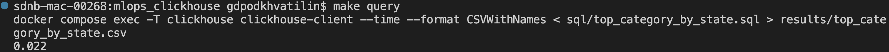
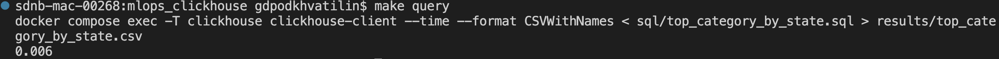

# HW2 ClickHouse

Скрипт отправляет транзакции из CSV в Kafka по одной, ClickHouse читает топик и сохраняет их в таблицу. SQL-запрос находит категорию самой крупной транзакции в каждом штате.

## Запуск

Перед запуском добавьте датасет в папку `data` с именем `train.csv` или укажите свой путь через `CSV_PATH`.

```bash
make run      # поднять Kafka, Kafka UI и ClickHouse; таблицы создаются при первом старте
make script   # отправить CSV в топик transactions
              # опционально: CSV_PATH=/path/to/file.csv, по умолчанию data/train.csv
make query    # выполнить SQL запрос для поиска категории наибольшей транзакции по каждому штату
              # опционально: RESULT_PATH=results/result.csv, по умолчанию results/top_category_by_state.csv
```

Между `make script` и `make query` подождите ~15 секунд: ClickHouse забирает данные из Kafka не мгновенно.

## Компоненты

| Сервис | Что делает |
|---|---|
| `zookeeper` | координатор для Kafka |
| `kafka` | брокер сообщений |
| `kafka-setup` | создаёт топик `transactions` и завершается |
| `kafka-ui` | веб-интерфейс для просмотра топиков |
| `producer` | `producer/run.py`: читает CSV и отправляет каждую строку отдельным сообщением. Запускается через `make script` |
| `clickhouse` | при первом старте выполняет `sql/ddl_optimized.sql` и начинает читать топик |

Таблицы в ClickHouse:

| Таблица | Движок | Роль |
|---|---|---|
| `transactions_kafka` | Kafka | читает топик `transactions` в формате `JSONEachRow` |
| `transactions_mv` | MaterializedView | перекладывает прочитанное в `transactions`, переводит `transaction_time` в `DateTime` |
| `transactions` | MergeTree | хранит транзакции |

SQL-скрипты:

- `sql/ddl_optimized.sql` - DDL таблиц, применяется при старте;
- `sql/ddl_naive.sql` - DDL до оптимизации для сравнения, никуда не подключён;
- `sql/top_category_by_state.sql` - SQL запрос категории наибольшей транзакции по каждому штату.

## Улучшения DDL

`ddl_optimized.sql` отличается от `ddl_naive.sql` только таблицей `transactions`:

| | naive | optimized |
|---|---|---|
| Ключ сортировки | `transaction_time` | `(us_state, cat_id, transaction_time)` |
| Тип `merch`, `cat_id`, `gender`, `us_state`, `jobs` | `String` | `LowCardinality(String)` |

- Сортировка по штату и категории: строки одного штата лежат рядом, поэтому колонки, которые читает запрос, сильнее сжимаются, а запросы с фильтром по штату смогут читать только нужную часть таблицы.
- `LowCardinality`: в этих колонках мало уникальных значений (от 2 у `gender` до 693 у `merch`), поэтому вместо строк хранятся номера из словаря.

Время одного SQL запроса на 786431 запись из датасета: 0.022 секунды с naive и 0.006 секунды с optimized (ускорение в ~3.5 раз).

naive:



optimized:


